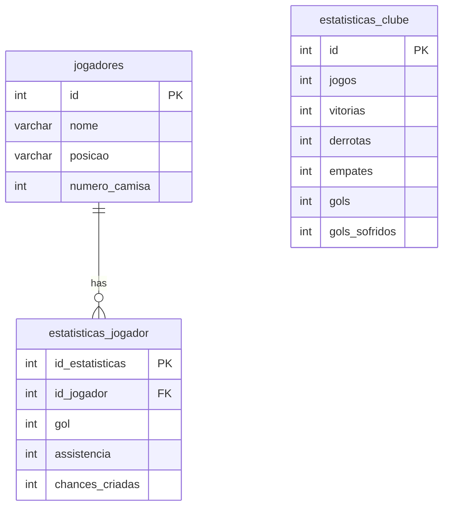

# SCCP Data Analytics & Database Project

 

**Main portfolio project — relational database and SQL analytics.**

A database project focused on Sport Club Corinthians Paulista players and club performance statistics for the 2026 season. It covers relational modeling, data population, referential integrity, and analytical views.

## Data model

- `jogadores` — player names, positions, and shirt numbers.
- `estatisticas_jogador` — goals, assists, and chances created, linked to each player.
- `estatisticas_clube` — matches, wins, draws, losses, and goals for and against.

The model uses primary keys, a foreign key between player statistics and players, and default values for numerical statistics.



## Analytical views

- **`vw_desempenho_jogadores`** joins players and their statistics, calculating direct goal contributions as goals plus assists.
- **`vw_estatisticas_clube`** calculates goal difference and the percentage of available points earned.

## Repository structure

```text
.
├── sccp-analytics-db/
│   └── scripts/
│       ├── schema.sql   # Database, tables, and constraints
│       ├── seed.sql     # Initial player and statistics data
│       └── view.sql     # Analytical views
└── README.md
```

## Run locally

Requirements: a MySQL server and a SQL client such as MySQL Workbench or the MySQL command-line client.

```sh
git clone https://github.com/Kleber720/bancodeDadosCOR.git
cd bancodeDadosCOR
mysql -u root -p
```

From the MySQL client, run the scripts in this order:

```sql
SOURCE sccp-analytics-db/scripts/schema.sql;
SOURCE sccp-analytics-db/scripts/seed.sql;
SOURCE sccp-analytics-db/scripts/view.sql;

SELECT * FROM vw_desempenho_jogadores LIMIT 10;
SELECT * FROM vw_estatisticas_clube;
```

## Technologies and skills

SQL, MySQL, relational modeling, referential integrity, joins, analytical views, Mermaid diagrams, and Git/GitHub.

The SQL identifiers retain their original Portuguese names to match the source scripts.


---

[Kleber Amaro’s portfolio](https://github.com/Kleber720) · [All repositories](https://github.com/Kleber720?tab=repositories)
