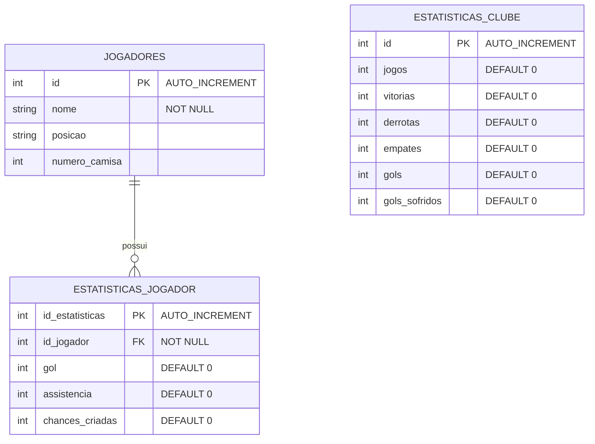

# SCCP Data Analytics & Database Project

## Visão Geral
Este projeto consiste no desenvolvimento de um banco de dados relacional e camadas de visualização de dados voltados à análise de desempenho do elenco do Sport Club Corinthians Paulista na temporada 2026. 

O objetivo principal é demonstrar o ciclo completo de dados: desde o levantamento das regras de negócio, modelagem conceitual e física na 3ª Forma Normal (3FN), até o povoamento e a criação de visões analíticas (`Views`) otimizadas para consumo por ferramentas de Business Intelligence (BI).

---

## Estrutura do Banco de Dados

### Diagrama Entidade-Relacionamento (DER)



---

## Estrutura dos Scripts e Arquivos

```text
.
├── scripts/
│   ├── 01_schema.sql        -- Criação do banco de dados, tabelas e restrições
│   ├── 02_seed.sql          -- Inserção dos dados do elenco e estatísticas
│   └── 03_views.sql         -- Construção das Views de análise de desempenho
├── docs/
│   └── diagrama.md          -- Representação técnica da modelagem
└── README.md                -- Documentação técnica do projeto
```

---

## Recursos e Modelagem SQL

### 1. Modelagem Relacional e Integridade Referencial
O banco foi modelado garantindo a integridade dos dados por meio do uso de Chaves Primárias (`PRIMARY KEY`), Chaves Estrangeiras (`FOREIGN KEY`) com restrição `NOT NULL`, e atribuição de valores padrão (`DEFAULT 0`) para prevenção de valores nulos em cálculos agregados.

### 2. Camada Analítica (Views)
Foram desenvolvidas visões para abstrair a complexidade de consultas e entregar dados prontos para a camada de visualização:

* **`vw_desempenho_jogadores`**: Executa o relacionamento (`JOIN`) entre as tabelas de atletas e estatísticas individuais, calculando dinamicamente a métrica de participações diretas em gols (`gols + assistências`).
* **`vw_estatisticas_clube`**: Consolida os dados do clube, realizando os cálculos de **Saldo de Gols** (`gols_pro - gols_sofridos`) e a taxa de **Aproveitamento de Pontos (%)** segundo a fórmula oficial do futebol.

---

## Como Executar o Projeto

### Pré-requisitos
* MySQL Server 8.0 ou superior (ou container Docker com MySQL).
* Cliente SQL (VS Code com extensão Database Client, DBeaver ou MySQL Workbench).

### Passo a Passo

1. Clone o repositório para o seu ambiente local:
   ```bash
   git clone [https://github.com/SEU-USUARIO/SEU-REPOSITORIO.git](https://github.com/SEU-USUARIO/SEU-REPOSITORIO.git)
   ```

2. Execute o script de criação do schema:
   ```sql
   SOURCE scripts/01_schema.sql;
   ```

3. Execute o script de povoamento inicial (Seeding):
   ```sql
   SOURCE scripts/02_seed.sql;
   ```

4. Crie as Views analíticas:
   ```sql
   SOURCE scripts/03_views.sql;
   ```

5. Valide a instalação consultando a visão consolidada de atletas:
   ```sql
   SELECT * FROM vw_desempenho_jogadores LIMIT 10;
   ```

---

## Tecnologias Utilizadas

* **Linguagem DDL/DML:** SQL (ANSI / MySQL 8.0 dialects).
* **Modelagem:** Mermaid.js.
* **IDE/Ambiente:** Visual Studio Code.
* **Controle de Versão:** Git e GitHub.